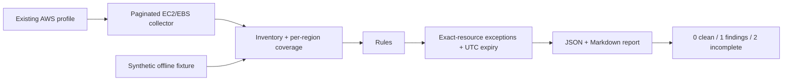

# AWS Governance Auditor

[](https://github.com/dhanraj002/aws-governance-auditor/actions/workflows/ci.yml)

A read-only Python tool for reviewing EC2 security groups and EBS volumes across explicitly selected AWS regions. It answers a practical operations question: **what needs attention, who owns the exception, and did the scan actually finish?**

The tool keeps findings separate from collection failures. An access-denied response on page two does not become an empty, successful scan. Accepted risks remain visible and become active again when their exception expires.

## Checks

Related operational workflow: [PHP inventory and reviewed SSM remediation](php-ssm/README.md). This separate tool exports PHP evidence for Excel review and prepares an approval-gated, single-host patch change. The EC2/EBS auditor below remains read-only.

| Rule | Evidence | Interpretation |
|---|---|---|
| `SG_PUBLIC_ADMIN` | IPv4/IPv6 `/0` ingress includes TCP 22 or 3389, including ranges and all-protocol rules | Review the group; this alone does not prove internet reachability |
| `EBS_UNENCRYPTED` | AWS reports `Encrypted=false` | Plan an encrypted replacement; no in-place toggle |
| `EBS_UNATTACHED` | Volume is `available` with no attachments | Ownership/retention review candidate, never automatic deletion |
| `MISSING_TAGS` | Blank or absent `Owner`, `Environment`, `CostCentre` | Identify accountability before making changes |

## Try it without an AWS account

Python 3.11+ on Linux or macOS is enough for the offline demo. Run from the repository root:

```bash
python3 -m auditor --snapshot examples/inventory.json --output reports/demo
```

**Exit code 1 is expected:** the synthetic inventory deliberately contains four findings. Open `reports/demo/report.md` or `report.json`. The example account and resources are fictional. A saved [sample report](examples/sample-report.md) shows the output without running anything.

```bash
python3 -m auditor --snapshot examples/inventory.json \
  --exceptions examples/exceptions.json --output reports/with-exceptions
```

The example exception expires at 00:00 UTC on 1 November 2026. After that date its finding becomes active again. Other findings still produce exit code 1.

## Live read-only collection

```bash
python3 -m venv .venv
source .venv/bin/activate
python -m pip install -c requirements-aws.lock '.[aws]'
# Sign in through your existing AWS SSO/profile first.
aws-governance-audit --live --profile sandbox \
  --regions eu-central-1 eu-west-1 --output reports/live
```

Live mode calls STS GetCallerIdentity, EC2 DescribeSecurityGroups and EC2 DescribeVolumes only. It does not create, tag, encrypt, detach or delete resources. Credentials use the normal AWS SDK chain; there are no command-line key arguments.

The optional [Terraform policy](infra/main.tf) grants those two Describe permissions in selected regions. It creates only an unattached managed policy, not a role or credentials. An administrator must review and attach it to the intended existing identity. No AWS credentials are configured in CI.

## How it works



| Exit | Meaning |
|---|---|
| `0` | Collection complete for requested scope; no active finding at or above the chosen threshold |
| `1` | Collection complete; active findings meet `--fail-on` (default: medium) |
| `2` | Collection incomplete, invalid input, authentication failure or another execution error |

Excepted findings are retained. Incomplete collection takes precedence over findings in the exit code. Empty inventory is meaningful only when every requested region/type completed successfully.

## Test and inspect

```bash
python -m pip install -c requirements-aws.lock '.[aws]'
python -m unittest discover -s tests -v
terraform -chdir=infra init -backend=false
terraform -chdir=infra validate
terraform -chdir=infra test
```

CI runs Python 3.11 and 3.13, botocore Stubber tests, an offline CLI demonstration, and mocked Terraform policy checks. [Validation notes](docs/validation.md) distinguish these checks from a live-account audit.

- [Design decisions and limitations](docs/design.md)
- [Exception format and review process](docs/exceptions.md)
- [Operations runbook](docs/runbook.md)

This is a focused portfolio project, not a replacement for AWS Config, Security Hub or a full network reachability analysis. It complements [aws-terraform-cloud-platform](https://github.com/dhanraj002/aws-terraform-cloud-platform): one project builds and releases a workload; this one reviews existing infrastructure without changing it.
